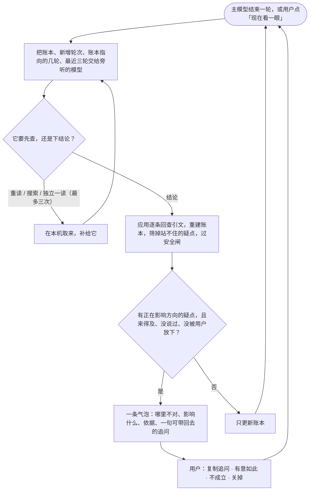

# 伴行 · 旁听一条长对话

> 产品设计与实施状态 · 2026-11-19
> 这一版是**推倒重做**。此前的草稿路线（v0.3）不再是产品的一部分，原样存档在
> [`legacy/v0.3/`](../legacy/v0.3/README.md)。本文是现在这个应用的设计依据；它开头的「实施状态」随代码更新，
> 逐项证据等级在 [`verification.md`](verification.md)。

---

## 实施状态（0.4.0a2，预览版）

**写作条件**：Linux；没有 Windows、没有模型密钥、没有任何真实对话。可以联网查文档。
所以下面凡写「通过」的都是 **E1**（离线自动化测试：合成对话，脚本写好的或离线替身的回复）。
**真实的旁听模型判断得好不好、真实对话读不读得对、在真实的 Windows 桌面上好不好用——全部是 E0。**
0.4.0a1 在 Windows 运行器上测试通过、打包后起得来（E2，[EV-2026-012](evidence/EV-2026-012.md)）；仅此而已。

**已实现**：第 3–7 节描述的全部内容——六种来源的读取、账本及其出处规则、带回查 / 搜索 / 独立一读的多步审查、六类疑点及各自的出处要求、
气泡规则、用户的四种回应及其后续跟踪、逐条同意与使用范围、加密或不存、桌面外壳（图标、气泡、账本窗口、选对话、模型设置）、
命令行（`--watch`、`--stepwise`、`--replay`）、带标注的逐轮回放评测。

**0.4.0a2 新增**（设计不变，只动了「怎么让人看得明白、用得上」）：
- 使用说明：第一次启动自动打开，三步各自标出用户现在到了哪里，并带一个直接去做的按钮；以后在菜单里。
- 账本窗口：顶上一行汇总，条目按依据分色（没查过 / 被推翻 / 有依据），可滚动、可缩放，刷新不丢阅读位置。
  颜色只是把账本已有的状态画出来——哪一行是什么状态仍由 `watch/ledger.py` 决定，`ui/viewmodel.ledger_rows` 只负责标注。
- 气泡标出疑点的分量（正在影响方向 / 记一笔）；鼠标停在图标上显示状态；对话框同种只开一个、Esc 关闭、居中。
- Windows 安装程序（Inno Setup，按用户安装）：创建入口、登记卸载；升级和卸载都不动 `%APPDATA%\Banxing`。

**没有实现**（第 9 节展开）：浏览器里的实时跟随；自动认出「眼前这条对话」；同时旁听多条；旁听模型与另一家服务并用；
流式；token 计数与每日上限；提示词的英文版；任何真实对话上的评测。

**没有运行过的**：Windows 上的一切（包括新写的界面和 `winshell.py`）；真实的 ChatGPT 导出、Codex 会话、Claude Code 会话；
App Server；两份提示词在任何真实模型上；真实 Windows 桌面上的任何交互。0.4.0a2 新增的界面只在 Linux 上跑过、看过；
安装程序及其构建、检查脚本在提交时**一次也没有跑过**（开发环境没有 Inno Setup 和 PowerShell），第一次运行就是 CI。

---

## 1. 问题

和一个很强的模型做一段长对话——研究、分析、设计——最危险的不是它哪一步做不好，而是**整段对话慢慢走到了一个不太对的地方，而没有人察觉**。
三个原因叠在一起：

1. **模型认自己的账。** 一句话一旦由它说出，后面的轮次就把它当成已知。第 7 轮的「这个应该没问题」，到第 40 轮已经是地基。
   它不会回头怀疑自己的前提，因为从它的上下文看，那就是事实。
2. **早先的东西会淡。** 用户在第 2 轮给的限制、最初要回答的那个问题，随着上下文变长（或被宿主压缩成摘要）而失去分量。
3. **人只读最新一轮。** 回一句「好，继续」很省事；重读四十轮很费事。于是唯一有能力纠偏的人，实际上也在跟着走。

把对话拿给另一个模型看，是个自然的办法——但手工做很不方便：要导出、要粘贴、要重新交代背景，而且得**记得**去做。
伴行就是把这件事做成一个常驻在旁边的小应用。

## 2. 为什么「再找一个模型看看」本身不够

如果只是把四十轮对话丢给第二个模型问「你觉得怎么样」，得到的多半是一篇附和。三个陷阱：

- **第二个模型也会被带着走。** 它读到的是第一个模型连贯、自信的长篇论述；读完之后，它的「判断」已经锚定在那套说法上了。
- **「看起来合理」不是证据。** 两个模型都觉得合理，只说明这段话写得通顺。真正的问题是：哪些东西**被检查过**，哪些只是**被说过**。
- **话多的监督者会被关掉。** 每轮都提醒「也许可以再确认一下」，三天后没人再看它。

所以这个应用的设计，全部是在回答一个问题：**怎样让第二个模型的旁听真的独立、对得上原文、并且只在该说话的时候说话。**

## 3. 五个支点

### 3.1 账本，不是摘要

伴行在对话**之外**维护一本账，由旁听的模型来记、由应用来把关：

| 账上记什么 | 怎么算数 |
| --- | --- |
| **用户想回答的问题** | 必须引得出用户自己的原话才算「确认过」。主模型写得再完整的计划，也只是它的提法。用户亲手改写过的目标一直保留，直到用户自己在对话里改口。 |
| **立足点**：定下的做法、被当作成立的前提、用户给的限制、已经得到并在用的结果 | 每条都要引出原文。**它凭什么成立由应用判定**：出处是记录（真正跑过的命令和输出）或用户原话的，算「有依据」；只有主模型自己说过的，算「没查过」。旁听的模型把它标成什么都不改变这一点。 |
| **提过的问题和用户的处理** | 带回去问了 / 有意如此 / 不成立 / 后来解决了。解决必须引得出**之后**的记录或用户的话——主模型说一句「没问题」不算。 |

整套产品压在一条规则上：**主模型的话，不能给主模型的结论作证。** 这条规则不写在提示词里指望模型遵守，而是写在
`watch/ledger.py` 里：每条引文由应用到它所说的那一轮去找，找到了才算数，并且**在哪一部分找到的**（用户的话 / 主模型的话 / 记录）
由应用记下，不采信模型的说法。

账本比摘要有用的地方在于：它不随主模型的上下文压缩而丢失；用户随时能看；「走偏」是对着它查出来的，而不是凭印象。

### 3.2 独立一读

主模型刚下了一个结论、选了一个方向，而手里只有它自己的说法时，旁听的模型可以要一份**独立一读**：另起一次调用，
只给它用户的话和记录，**把主模型说过的每一句都拿掉**，问：就这个问题，现有证据支持什么、不支持什么、你下一步会做什么？

然后把这份看法和主模型实际的走向放在一起。两份独立形成的判断不一致的地方，才是值得打断用户的信号；一致的地方不必多说。
这是整个流程里唯一没有被主模型的叙述带着走的一次阅读。

### 3.3 它自己决定去查什么

旁听的模型不是被喂一段上下文然后要求表态。它分步工作，每一步可以选择先不下结论，而是：

- **重读**指定的旧轮次；
- **在全文里搜**一个词——应用在本机搜，告诉它最早和最近出现在哪一轮、谁说的。**搜不到也是答案**：
  「从头到尾没有人验证过这件事」往往就是这样确立的；
- 要一份**独立一读**。

查的次数有上限（一次审查最多回头三次），每次请求都计入使用范围。账本窗口里写着它这次回头看了哪几轮、搜了几个词、有没有做独立一读。

### 3.4 一句能带回去的话

每个疑点都带一句**用户可以原样发给主模型的追问**——中立、具体、要求对方拿出证据而不是表态：

> 你在第 3 轮说 A 和 B 用的是同一份索引。请贴出两套方案各自的索引路径和构建时间；如果没有实际核对过，请现在核对并给出输出。

点一下就复制到剪贴板。这解决的正是「在模型之间流转不方便」：伴行替你把第二个模型的疑问翻译成第一个模型答得上来的问题，
而**发不发、怎么发仍然是你的事**——伴行不往任何应用里写一个字。主模型怎么回答，伴行接着读；回答里有记录，账上那一条就从「没查过」变成「有依据」。

### 3.5 克制

自己出声的门槛（`watch/nudge.py`）：

- **有出处**：引文在原文里找得到（否则这个疑点根本不存在）；
- **正在影响方向**：引得出**眼下**哪一步正靠它往前走。引不出的，记在账上，不打断；
- **来得及**：主模型刚结束一轮，用户还没发出下一条；
- **只说一次**：同一个疑点、同一组出处，只出一次；
- **听用户的**：用户关掉、说「有意如此」、说「不成立」、带回去问了、或者干脆往下走了——这一类疑点就不再出现，
  直到目标或立足点真的变了。

一次只出一条。用户**主动**点「现在看一眼」时，永远有回答：最重的一条疑点，或者一句「没有发现走偏，因为……」。

用户说「不成立」的比例记在本机（`--summary` 的 `wrong_rate`）。这是判断这个旁听者值不值得继续说话的那个数字。

## 4. 什么叫「思路歪了」

六种，每种应用都要求它**拿得出相应的出处**，拿不出就不显示：

| 类型 | 情形 | 必须引得出 |
| --- | --- | --- |
| **目标漂移** | 现在做的事已经不在回答用户的问题，而用户没有改过口 | 用户的目标原话 |
| **前提没查过** | 后面的工作压在一个只有主模型自己说过的前提上 | 主模型的那句话 |
| **结论超出证据** | 说得比拿到的结果能支持的更强 | 主模型的那句结论 |
| **前后矛盾** | 现在的做法与先前定下的限制或结果冲突，而没有人指出 | 相冲突的两处 |
| **过早收窄** | 别的可能没给理由就被放下，后面全压在一条路上 | 至少一处 |
| **原地打转** | 一直在同一处加工，没有带来会改变判断的新东西，而能带来反馈的那一步明明可以做了 | 至少一处 |

最后一种——该去拿反馈了却还在加工——是这个方向最初想解决的唯一情形；在这里它只是六种之一。

不算走偏的：正在排查一个真实的障碍；用户自己选的路；探索阶段的发散；措辞谨慎、与证据相称的结论。
判断留给旁听的模型，提示词里的原则是三问——**它错了的话，现在的方向会不会变？有没有人查过？用户是不是已经知道并且有意如此？**

## 5. 一次审查怎样进行

- **第一次**读用户允许范围内的全部历史，太长就分段（中间段只更新账本）。**之后**每次只带新增轮次、账本条目指向的少数几轮、
  以及紧挨着的最近三轮；其余的由旁听的模型自己决定要不要回头看。
- **什么时候审查**：只在主模型结束一轮、没有东西在运行的时候——那是用户正在决定下一步的时候。主模型还在工作时什么都不问。
- **回复不合格**（不是结论、疑点全站不住）：没人问时保持安静，用户主动看时报错并可重试。失败的请求不自动重发。
- **对话的历史变了**（改写了早先的消息、换了分支）：停下，不再提交，等用户确认旁听哪一条；确认后账本重建。

## 6. 读哪里的对话

| 来源 | 怎么读 | 实时性 |
| --- | --- | --- |
| **剪贴板里的聊天页面** | 在任何网页聊天里全选、复制；伴行按「You said / ChatGPT said」这类标记切成轮次 | 对话长了，再复制一次，菜单里点「从剪贴板再读一次」 |
| **ChatGPT 官方导出** | zip、解包后的文件夹或对话文件；只读当前分支；工具的运行与输出记为「记录」 | 导出是静态的，适合事后回看 |
| **Codex** | 会话文件，或 App Server 的分页历史（`thread/turns/list`） | 文件一变就再读；每轮结束后自动审查 |
| **Claude Code** | 会话文件；工具调用与结果记为「记录」 | 同上 |
| **文字稿** | 自己的 JSON 或带标记的文本 | 文件一变就再读 |

网页聊天没有官方的实时接口，所以对它们用的是最朴素也最通用的办法：**复制整页**。代价是这样读到的对话里没有任何「记录」——
主模型说它跑了什么，都只是它的话。这恰好是账本本来的态度：在那种对话里，几乎一切都是「没查过」，除非用户自己贴了输出。

伴行**只读**用户指给它的那个文件、线程或剪贴板，不读也不写任何应用的窗口。

## 7. 隐私与安全

- **逐条同意。** 开始旁听的窗口写明这条对话从第几轮起发往哪个地址（协议、主机、端口）、用哪个模型。同意只对这条对话、这个地址有效；
  地址一变（包括环境变量覆盖）立刻停止，直到重新确认。命令行每次运行都要用 `--agree 地址` 写明。
- **范围。** 用户指定从第几轮开始读；更早的轮次任何情况下都不提交，旁听的模型主动要也不给。
- **看得见。** 账本底部常驻：读到第几轮、提交过哪些轮次、多少字、几次请求、发往哪里；还能看上一次提交的全文和独立一读的原话。
- **不复制对话。** 伴行只记住去哪里再读。账本默认只在内存里；勾选后才加密保存在本机（Windows DPAPI，加密失败就不保存并明说），
  结束旁听或清除本机数据即删除。
- **对话内容只是资料。** 旁听模型的回复逐条回查；出现对话里没有的网址、把密钥发到别处、下载后直接执行、要求忽略先前指示之类的内容，
  整份回复丢弃，连同它带来的账本。
- **密钥与线路**（沿用并保留了 v0.3 的全部测试）：API Key 绑定输入它时的服务和地址，换地址不跟随；不跟随重定向；
  一次尝试一个请求，HTTP 400 不改写重发；地址必须是 https（本机除外）。
- **本机记录只有数字和代号**：事件日志拒收任何成句的文字；`--watch`、`--replay` 写出的报告里只有轮次号和类型名。

## 8. 它和现有的东西有什么不同

- **和「让模型自我反思」**：自我反思用的是同一个上下文、同一套已经相信的前提。伴行在对话之外，用另一个模型，而且有一次阅读完全不看主模型的话。
- **和代码审查 / 事实核查类工具**：那些检查的是产出物对不对。伴行检查的是**这段对话立在什么上面**——哪一句没查过的话正在承重，
  用户的问题还在不在被回答。
- **和记忆 / 摘要类插件**：摘要把主模型的说法压缩后再喂回去，等于替它巩固自己的前提。账本区分「说过」和「查过」，而且是给用户看的。
- **和 `grill-me` 这类技能**：那是在开工前把想法问清楚——仍然有用，伴行不做这件事。伴行管的是开工之后、四十轮之中。
- **和一个更啰嗦的助手**：它绝大多数时候不说话。说话时给的不是建议，而是一处对得上原文的疑点和一句可以带回去的追问。

## 9. 没有做的，和已知的弱点

- **旁听的模型判断得准不准，没有任何证据。** 规则保证它说的话对得上原文、拿得出该拿的出处；规则不能保证它看得出真正的问题，
  也不能保证它不把合理的工作说成走偏。这要用真实模型、真实对话来量（第 10 节）。
- **两个模型可能错在同一处。** 换一家模型降低了共谋，但消除不了；独立一读降低了锚定，但它用的仍是同一个旁听模型。
- **「正在影响方向」是旁听模型的判断加一条机械规则**（引得出最近三轮里的一步）。机械规则可能把一个陈年问题放过，也可能被一句泛泛的引文骗过。
- **网页聊天不是实时的**：要用户自己再复制一次。浏览器扩展可以解决，但那是另一个量级的工程和权限，没有做。
- **不自动认出眼前的对话**：由用户选。认错对话比不认更糟。
- **成本**：第一次回查长对话可能很贵，窗口里没有预估；计的是字数和请求次数，不是 token；没有每日上限。
- **一次一条对话**；旁听模型只能配一个服务；提示词只有中文（回复跟随对话的语言）；没有流式。
- **`intended`/`wrong` 的静音按「类型」算**：用户说某个前提是有意的，同类的另一个前提在立足点没变之前也不会自己弹出来
  （「现在看一眼」不受影响）。这是偏安静的取舍。

## 10. 怎样知道它有没有用

1. **逐轮回放带标注的对话**（`--replay`）。成对的案例——只差关键的一点：说过没查 / 说过也跑过；主模型自己跑偏 / 用户自己改了目标；
   一次运行就下定论 / 一次运行但说得谨慎；原地加工 / 在查真问题。量三样：**时机**（在错误被继续加码之前提出，富余几轮，错过几次）、
   **准头**（类型对不对，引文是不是指到了该指的地方）、**误打扰**（该安静时出声、过早、用户回应之后又弹）。另加一个**对照**：
   同一个模型在关键轮次只读一次。逐轮旁听若不比读一次强，就不值得常驻。
2. **回放真实对话**（`--watch 路径 --stepwise`）。没有标注，只列出每一轮之后它会不会出声；由对话的主人逐条判断：这处疑点是不是真的、
   来得及不及、有没有漏掉的。
3. **试用**。`--summary` 给出本机的计数：出声几次、带回去问几次、有意如此几次、不成立几次、后来被记录解决几次。
   「不成立」的比例长期偏高，就该改提示词或者干脆让它更安静。

现在只有第 1 项用离线替身跑通过（替身是对着这些案例写的关键词规则，它「全对」不说明任何问题）。
